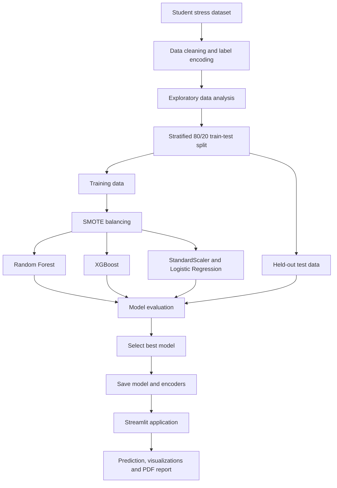

# Student Stress Level Prediction


## Overview

Student Stress Level Prediction is a machine learning project that classifies students' academic stress into **Low Stress**, **Moderate Stress**, and **High Stress** using demographic information and responses to a ten-question academic stress questionnaire.

The project compares Logistic Regression, Random Forest, and XGBoost. Logistic Regression achieved the highest recorded test accuracy of **98.77%** and was selected for the interactive Streamlit application.

## Features

- Three-class stress level prediction.
- Data cleaning, label encoding, and exploratory data analysis.
- SMOTE-based training class balancing.
- Comparison of three machine learning classifiers.
- Interactive questionnaire with response sliders from 0 (Never) to 4 (Very Often).
- Class probability visualization and stress-pattern radar chart.
- Questionnaire-based student summary and downloadable PDF report.
- Model and preprocessing artifact serialization using Joblib.

## Dataset

The notebook uses `Stress.csv`, containing 2,028 records and 19 original columns. The model uses 15 input features.

| Feature group | Features |
| --- | --- |
| Demographic and academic details | Age, Gender, Academic Year, CGPA, Scholarship |
| Questionnaire | Q1–Q10 |
| Target | Stress_Label |

University, Department, and Stress_Value are not included in the feature matrix.

### Class distribution

| Stress level | Full dataset | Training set | Test set | Training after SMOTE |
| --- | ---: | ---: | ---: | ---: |
| High Stress | 565 | 452 | 113 | 1,078 |
| Low Stress | 115 | 92 | 23 | 1,078 |
| Moderate Stress | 1,348 | 1,078 | 270 | 1,078 |
| **Total** | **2,028** | **1,622** | **406** | **3,234** |

## Technology Stack

| Category | Technologies |
| --- | --- |
| Language | Python |
| Data processing | Pandas, NumPy |
| Machine learning | Scikit-learn, XGBoost |
| Class balancing | Imbalanced-learn (SMOTE) |
| Visualization | Matplotlib, Seaborn |
| Web application | Streamlit |
| Model persistence | Joblib |
| PDF generation | FPDF |
| Development | Google Colab / Jupyter Notebook |
| Temporary app access | Cloudflare Tunnel |

## Project Workflow



### Model configuration

- **Random Forest:** 300 estimators, random state 42.
- **XGBoost:** 300 estimators, learning rate 0.08, maximum depth 6, multiclass probability objective.
- **Logistic Regression:** multinomial classification, LBFGS solver, maximum 2,000 iterations; features standardized using StandardScaler.

The stratified split uses random state 42. SMOTE is applied only to the training partition; the test partition retains its original class distribution. The scaler is fitted on the resampled training data.

## Model Performance

Results recorded in the supplied notebook on the 406-sample test partition:

| Model | Accuracy | Macro F1 | Weighted F1 |
| --- | ---: | ---: | ---: |
| Random Forest | 95.32% | 0.8910 | 0.9532 |
| XGBoost | 94.83% | 0.8794 | 0.9489 |
| **Logistic Regression** | **98.77%** | **0.9786** | **0.9878** |

Logistic Regression was selected based on accuracy. It also achieved the highest macro and weighted F1 scores in this experiment.

### Evaluation outputs

The notebook generates class distribution and correlation plots, model accuracy comparisons, confusion matrices, coefficient-based feature importance for Logistic Regression, actual-versus-predicted plots, class probability plots, and CSV classification reports.

## Project Structure

Suggested repository layout after executing the notebook and exporting its generated files:

```text
student-stress-level-prediction/
├── student_stresslevel_prediction_.ipynb
├── Stress.csv                       # Supply separately, if permitted
├── app.py                           # Generated by notebook
├── best_model.pkl                   # Generated by notebook
├── encoders.pkl                     # Generated by notebook
├── class_distribution.png
├── corr_heatmap_qs.png
├── confusion_matrices.png
├── confusion_matrix_lr.png
├── feature_importances.png
├── actual_vs_predicted_lr.png
├── probability_confidence_lr.png
├── report_rf.csv
├── report_xgb.csv
├── report_lr.csv
└── README.md
```

Only the notebook was supplied for preparing this README; the dataset and generated files must be obtained separately or generated by running it.

## Getting Started

### 1. Train the models in Google Colab

1. Open [Google Colab](https://colab.research.google.com/).
2. Upload `student_stresslevel_prediction_.ipynb`.
3. Run the dependency installation and data-upload cells.
4. Upload the original `Stress.csv` when prompted.
5. Run the preprocessing, training, evaluation, and `%%writefile app.py` cells.
6. Download `app.py`, `best_model.pkl`, `encoders.pkl`, and optionally `corr_heatmap_qs.png` into the same local folder.

The notebook includes Colab-specific upload and shell commands. These require adaptation if running in a different Jupyter environment.

### 2. Install dependencies locally

With Python installed, open a terminal in the project folder and run:

```bash
python -m pip install pandas numpy "scikit-learn<1.8" xgboost imbalanced-learn joblib streamlit fpdf matplotlib seaborn
```

For reliable model loading, use the same package versions as the training environment. The scikit-learn version constraint preserves compatibility with the notebook's explicit `multi_class` argument; exact training dependency versions were not recorded in the notebook.

### 3. Launch the Streamlit application

Ensure that `app.py`, `best_model.pkl`, and `encoders.pkl` are in the current directory.

```bash
python -m streamlit run app.py
```

Open **http://localhost:8501** in your browser.

The notebook also includes Cloudflare Quick Tunnel commands for temporary access from Colab. A tunnel URL is not a permanent hosted demo.

## How to Use

1. Select the demographic and academic details.
2. Answer the ten questionnaire questions using the sliders.
3. Click **Predict Stress Level**.
4. View the predicted class, probability chart, radar chart, and student summary.
5. Click **Download PDF report** to export the prediction and questionnaire scores.

## Limitations and Future Improvements

- The reported metrics come from a single split of one dataset, not independent external validation.
- Demographic encoders and missing-value imputation are currently fitted before splitting; future experiments should fit all preprocessing only on training data and evaluate using cross-validation.
- Verify whether the target label is derived directly from questionnaire scores, as this may explain the high accuracy.
- Review questionnaire ordering, positive-item scoring, and the app's rule-based summary before real-world use.
- Explore categorical-aware resampling, probability calibration, and validation on diverse student populations.
- Do not publish identifiable student records; verify dataset permissions before uploading data to GitHub.

## Disclaimer

This project is intended for educational and research purposes. Its predictions are not a clinical diagnosis or a substitute for assessment by a qualified mental health professional.

## Author

**Ravella Abhiram Chowdary**

